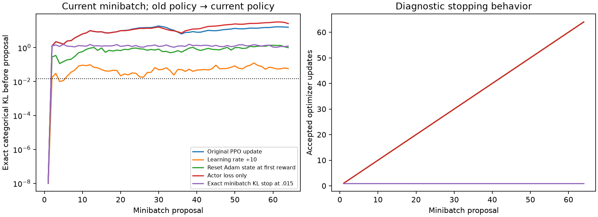

# First-reward PPO update: isolated counterfactuals

This diagnostic reproduces the update associated with seed 1's collapse, then
changes one update setting at a time. **It does not establish a better policy or
perform a new online learning experiment.** No counterfactual policy is exported.

## Reproduction and scope

Start from the actual saved step-zero full PPO checkpoint. Re-execute the
recorded prefix under the same configuration and sources. Thirteen reward-free
rollouts reproduce recorded rewards, terminal/action counts and all update
metrics; their parameters stay exactly unchanged. The first reward occurs in
rollout 14, ending at 28,672 decisions. The ordinary rewarded updater reproduces
the recorded metrics, including the large mean approximate KL. The instrumented
updater agrees with its full resulting state to maximum absolute floating error
0, with exact integer/boolean state equality.

The original raw trajectory batch was not archived; there is no bytewise
comparison against an original batch file. This is deterministic reconstruction
from the saved initial state, validated against the recorded per-rollout evidence.
All-action log probabilities are checked against the public policy API.

The online pilot's original first rewarded update had mean approximate KL about
9.78 and was followed by rotation-only behavior. This diagnostic's final full-
batch KL below is a different quantity: exact categorical KL over all five
actions and all 2,048 fixed observations, measured after the counterfactual
updates. The plotted KL is measured on each shuffled minibatch before its
proposal. Do not equate these three measurements.

## Same current-policy batch, isolated update choices

| Update choice | Accepted steps | Final full-batch exact KL | Final full-batch entropy | Encoder/actor L2 change |
| --- | ---: | ---: | ---: | ---: |
| Original PPO update | 64 | 15.78142 | 0.01070 | 8.27987 |
| Learning rate ÷10 | 64 | 0.06773 | 0.39142 | 0.80741 |
| Reset Adam state at first reward | 64 | 1.11780 | 0.80560 | 2.74778 |
| Actor loss only | 64 | 24.82331 | 0.00003 | 8.31022 |
| Exact minibatch KL stop at .015 | 1 | 1.27451 | 0.21072 | 0.59839 |

All branches begin with the same parameters, collected batch and shuffle RNG.
The smaller-rate branch keeps Adam state and changes its step scale from .0005
to .00005. The reset branch resets Adam moments/clock only at this diagnostic
point, retaining the model, collection state and training-step counter. The
actor-only branch sets the value-loss coefficient to zero. None changes the
main pilot. The original reward-free prefix advanced 832 optimizer steps before
task feedback; optimizer-clock effects are a hypothesis tested by the reset
comparison, not proof that standard Adam is incorrect.

The stopping branch checks exact categorical KL on the current minibatch before
accepting its proposed update. Once KL exceeds .015, it accepts no further
updates in that rollout. It does not undo an earlier overshoot or impose a hard
bound over the full batch. Instrumentation still calculates every proposal so
all traces can be inspected; accepted updates and computational work are separate.

## Interpretation and accounting

Use these results to choose the next controlled stability experiment. Retaining
an initialization or reducing KL alone is not learning; a subsequent fresh run
must discover rewards and improve original-score gameplay above its own starting
policy and random. No architecture change, offline replay or auxiliary loss is
introduced here. The current two-seed PPO pilot remains unchanged.

PPO clipping is not a hard limit on policy divergence. OpenAI's implementation
description uses KL-based early stopping, and Stable Baselines3 documents an
optional target-KL limit for this reason. These sources motivate testing a guard;
they do not establish that a particular guard fixes this experiment.
[OpenAI Spinning Up](https://spinningup.openai.com/en/latest/algorithms/ppo.html),
[Stable Baselines3](https://stable-baselines3.readthedocs.io/en/master/modules/ppo.html).

The diagnostic re-executes 28,672 known-prefix environment decisions, which are
not independent new experience. It performs 832 prefix optimizer updates, 64
oracle updates and 320 counterfactual gradient calculations. Those branches do
not supply checkpoints for further training, and the main PPO stage never reads
their data. Runtime overlaps the fixed pilot and is not an isolated benchmark.

[Machine-readable evidence](analysis.json) ·
[Original online pilot](../human_bc_100epoch_ppo_64k/RESULT.md) ·
[Implementation log](../../../IMPLEMENTATION_LOG.md).
