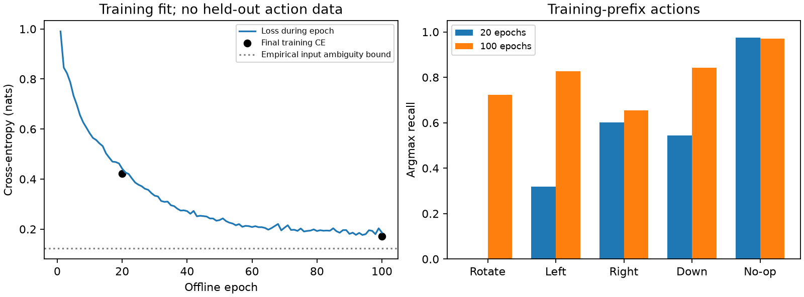

# Offline cloning duration: 20 versus 100 epochs

**Longer offline fitting does not pass the original-score screen; useful gameplay remains unestablished.**

The [predeclared protocol](../../../CLONING_DURATION_EXPERIMENT.md) changes only
offline duration. Both runs use seed 2, the same human prefix, CNN, four pixel
frames, action space, optimizer and shuffled minibatches. The 100-epoch run
starts fresh; its entire state at epoch 20 exactly matches the prior archived
cloning checkpoint, including parameters, Adam moments, RNG and counters.
Initial network hashes, first-20-epoch metrics and source snapshots also match
their declared checks. No PPO updates occur in this experiment.

## Original-score evaluation

| Policy/control | Scoring games |
| --- | ---: |
| clone_100_epochs | 1/128 |
| clone_20_epochs | 1/128 |
| scratch_ppo_64k | 1/128 |
| untrained_seed2 | 0/128 |
| random | 3/128 |
| noop | 0/128 |

All policies use the same 128 exploratory game seeds 50000–50127 and corrected
timing. Random and no-op episode arrays match the earlier controls exactly.
The weights-only evaluator exactly reproduces all eight monitoring episodes.
No checkpoint was selected by evaluation score; these are final-epoch weights.
The candidate screen is not a significance test. The fresh confirmation bank
60000–60511 remains unused. There is only one training seed and one human prefix.

## Offline fit

| Diagnostic | 20 epochs | 100 epochs |
| --- | ---: | ---: |
| Cross-entropy | 0.4222 | 0.1713 |
| Entropy (nats) | 0.4569 | 0.1870 |
| Argmax accuracy | 0.8554 | 0.9205 |

| True action | 20-epoch recall | 100-epoch recall |
| --- | ---: | ---: |
| Rotate | 0.00% | 72.34% |
| Left | 31.90% | 82.76% |
| Right | 60.21% | 65.45% |
| Down | 54.39% | 84.21% |
| No-op | 97.43% | 96.97% |

All fit and recall values are in-sample. The prefix has 76.56% no-op labels and
only 47 rotation labels. Conflicting actions on identical inputs impose an
empirical training CE lower bound of 0.12386
and argmax accuracy upper bound of 92.95%;
these do not predict gameplay performance or prove this CNN can reach them.
The curve shows loss averaged during each epoch; black points are the separately
measured final training losses, which are different quantities.

## Budget and next action

The new run uses 1,800 offline Adam updates and 224,000 presentations of the
same 2,240 demonstration decisions. It repeats the first 20 epochs for a strict
audit; it is not an 80-epoch continuation. Its recorded training time is
387.73 seconds, excluding validation and gameplay
evaluation. It executes 2,241 diagnostic replay transitions for dataset checking.
These are repeated known actions, not new experience. Evaluation episode lengths
are retained separately in the monitoring/comparison files. The offline report
itself collects zero environment decisions and performs zero updates.

Do not automatically spend a full PPO budget on this initialization. Diagnose remaining imitation errors and coverage/observation limitations. Better in-sample action fitting alone does not solve reward discovery.

The human prefix is incomplete (`complete=false`, original score 11); it is not
held-out data or a completed expert episode. Its raw archive remains local and
excluded from GitHub. Reproducing offline training/fit requires the separately
supplied checksum-matched recording. Published weights, sources and config permit
standalone gameplay evaluation and an independent fresh PPO process.

The actual-policy animation uses preselected seed 30016, without selecting a
successful game. See [the card](result_card.html), [full evidence](analysis.json),
[20-epoch summary](../human_bc_seed2/pretrain/summary.json), and
[implementation log](../../../IMPLEMENTATION_LOG.md).
