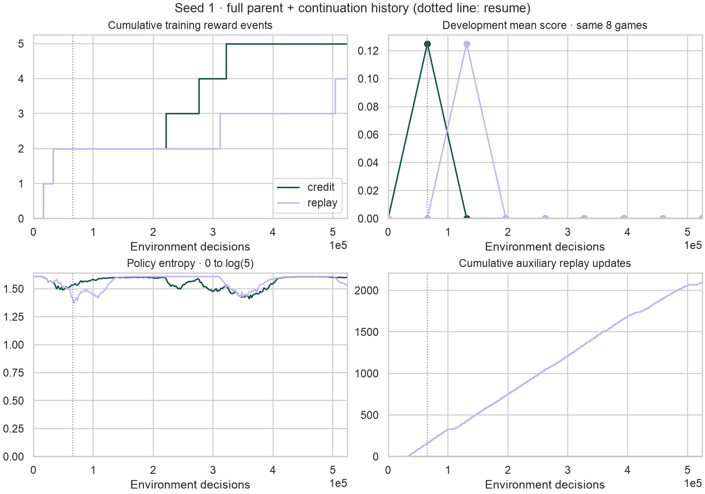

# Corrected PPO and score replay · 512K total steps

The on-policy PPO arm does not exceed both random and its untrained network; the learning objective remains unmet.

## Fixed continuation protocol

Both seed-1 arms resume their full 65,536-step states to 524,288 total decisions, adding 458,752 decisions each. These are continuations of the same selected training seed, not independent replications. Four-frame monochrome pixels, CNN, original score reward, keypress actions, corrected timing and longer-credit PPO settings remain fixed. Replay retains its full buffer, pending episodes and sampler RNG. Both arms receive 16,384 cumulative PPO optimizer updates; additional replay work is reported below.

The `credit` arm is online, on-policy PPO. The `replay` arm collects experience online but adds off-policy auxiliary updates from older episodes. The user clarified the intended on-policy scope while final evaluation was running. The replay branch is retained as a labeled side experiment; it cannot satisfy the strictly on-policy objective, and the prepared protected-retention variant is shelved.

## Cumulative experience and final scores

| Arm | Training reward events | Scoring games | Mean score | Extra replay updates |
| --- | ---: | ---: | ---: | ---: |
| credit | 5 (3 added) | 1/128 | 0.00781 | 0 |
| replay | 4 (2 added) | 1/128 | 0.00781 | 2105 |

The exact untrained seed-1 network scored 2/128; the shared random control scored 3/128. The corresponding 64K parents scored 1/128 for PPO and 0/128 for replay. Final evaluation uses the previously inspected seeds 50000–50127; paired comparisons and complete episode arrays are in `analysis.json`. These small counts on reused games cannot establish statistically convincing improvement. A candidate must be frozen and tested on unused seeds before a learning claim, with independent training-seed replication required for a dependable setup.

A separate uniform-random rollout at the same 524,288-decision budget encountered 4 reward events in 400 completed games. It starts from the same seed-1 reset scheme; its first 64K reward-event records exactly reproduce the earlier random control. This measures reward discovery over the training horizon, not held-out policy skill. Random and PPO action RNG paths and episode boundaries differ. The random rollout briefly ran alongside PPO, so reported training throughput is observed laptop throughput, not an isolated compute benchmark.

The curves include both parent and continuation. Their eight-game development scores are repeated monitoring measurements, separate from the final 128-game comparison. Combined raw metrics are exported beside the figure.

## Integrity and interpretation

The audit checks every global rollout step across parent and continuation, avoiding gaps or double counting. Reward/optimizer counters are summed across segments; replay's completed-episode counter is cumulative. Source/ROM snapshots and parent hashes, exact resumed initial evaluation, checkpoint roundtrips, finite metrics, repeated controls and the replay/model checkpoint pair all passed. Initial and periodic evaluation decisions are excluded from the training budget.

Final optimizer activity or increased survival alone does not meet the scoring objective. Replay is compared at equal environment experience, not equal compute. The illustrative card uses the preselected replay policy on gameplay seed 30016; it is not chosen for a high score.

The replay arm completed 4 scoring episodes cumulatively, but its final bounded FIFO buffer contains 582 positive-return transitions. These are different quantities: old successes can be evicted. Saved-checkpoint retention audits are in `replay_buffer_audit.jsonl`, including the sampling probability mass assigned to positive-return targets. This diagnostic does not change training or sampling.

See [protocol](../../../LEARNING_512K.md), [implementation log](../../../IMPLEMENTATION_LOG.md), and each arm's raw files and learning curves: [PPO](../v2_credit_horizon_512k_seed1/) and [replay](../v3_self_imitation_512k_seed1/).
