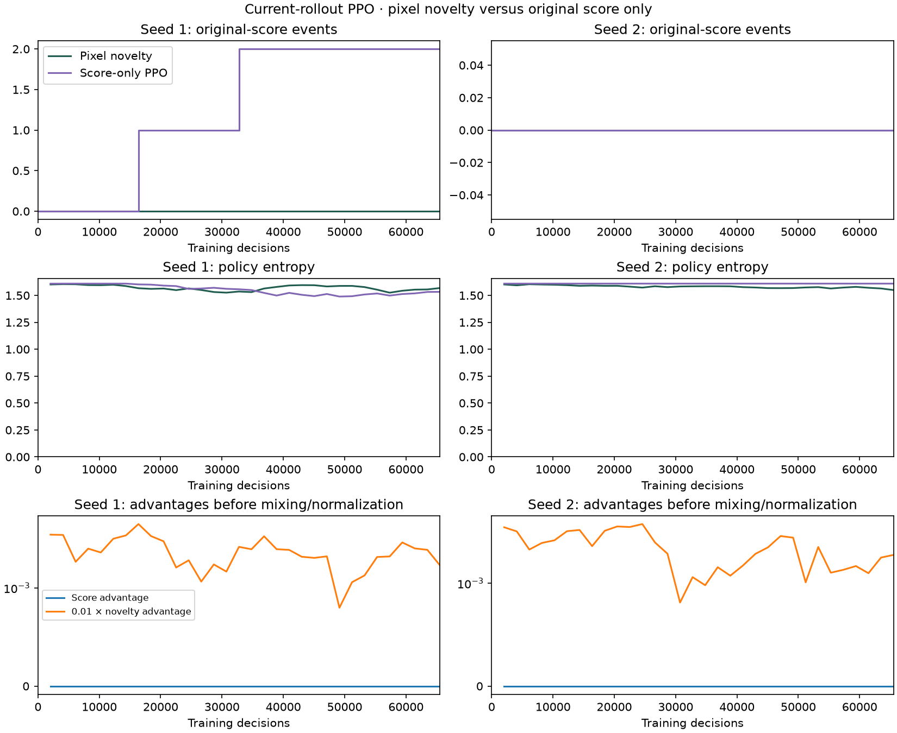

# Pixel-only novelty · online, on-policy PPO at 64K

Pixel novelty does not pass the two-seed original-score screen; useful on-policy learning remains unestablished.

Fresh seeds 1 and 2 each received 65,536 training decisions, 32 rollouts and 2,048 PPO updates. Actor observations remain four monochrome frames; no geometry, demonstrations or historical replay enters training. RND uses full newest-frame pixels, frozen bonuses per rollout, a fixed target and a predictor trained only on that current rollout. Original game score is the evaluation objective. The added value head and predictor each receive 2,048 optimizer updates; the shared CNN is also influenced by the intrinsic value loss. This is a complete exploration-method comparison, not a single-coefficient ablation.

| Seed | Training rewards: novelty / score-only / random | Novelty scoring | Score-only scoring | Untrained scoring | Shared random scoring |
| --- | ---: | ---: | ---: | ---: | ---: |
| 1 | 0 / 2 / 2 | 0/128 | 1/128 | 2/128 | 3/128 |
| 2 | 0 / 0 / 0 | 0/128 | 1/128 | 0/128 | 3/128 |

Final scoring uses the reused 128-game bank, seeds 50000–50127. Confidence intervals, paired exploratory comparisons, survival/action statistics, reward-discovery timing and exact control arrays are in `analysis.json`. Random is one shared control. The separate 16,384 smoke-training decisions and smoke evaluation decisions are recorded in `smoke_validation.json`; they are excluded from the 131,072 pilot-training decisions. Each run's summary records its monitoring evaluation decisions separately. Final comparison and illustration games are additional evaluation work, never policy updates. No normalization warm-up was used.

Initial parameter hashes and initial development arrays matched controls. Frozen source hashes, complete environment/update budgets, original-score logs, full-checkpoint restoration, fixed-target hashes, inference-export equality and repeated random/no-op arrays passed. No novelty or predictor metric by itself is learning evidence. The fresh confirmation bank remains unused.

[Actual-policy card](result_card.html) · [Protocol](../../../PIXEL_EXPLORATION_PROPOSAL.md) · [Implementation log](../../../IMPLEMENTATION_LOG.md)
