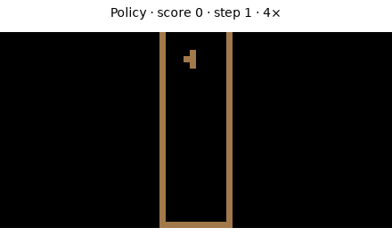

# Longer-credit PPO · 512K total decisions · seed 1

No scoring gain is established. The saved policy scored in **1/128 games**, versus its 64K parent 1/128, the exact untrained network 2/128 and uniform random 3/128. All scored games had return 1. The two PPO checkpoints scored on different game seeds despite the equal count. These are previously inspected seeds 50000–50127; this one-seed comparison is exploratory.

Training resumed the full 64K model, optimizer, RNG and emulator state and reached 524,288 decisions with unchanged corrected timing, four-frame pixel CNN and original game reward. Cumulative training: five reward events in 402 completed games, 16,384 PPO updates and approximately 144 observed decisions/s. The equal-budget random rollout encountered four rewards in 400 games. Discovery counts are separate from policy skill; random and PPO do not share identical action paths or episode boundaries.

All global-step, finite-metric, exact checkpoint-restoration, resumed initial-evaluation and repeated-control checks passed. Configurations, parent hashes, source/ROM snapshot, full checkpoint, metrics and raw evaluations are included. Training throughput includes brief overlap with the random-control diagnostic and is not an isolated hardware benchmark.

Illustrative preselected game seed 30016, score 0. [Interactive result card](result_card.html), [raw final evaluation](heldout/comparison.json), [protocol and reproduction](../../../LEARNING_512K.md), [implementation log](../../../IMPLEMENTATION_LOG.md). The matched replay continuation is still in progress at publication of this arm; the combined report will follow.
