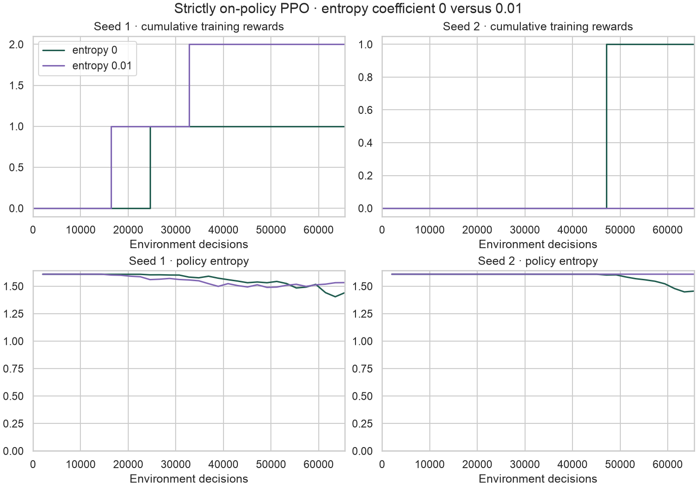

# On-policy PPO entropy ablation · two seeds at 64K

Removing entropy regularization does not pass the two-seed scoring screen; useful on-policy learning remains unestablished.

Fresh seeds 1 and 2 each received 65,536 decisions, 32 rollouts and 2,048 optimizer updates. Entropy coefficient 0 is compared with the saved 0.01 control. Resolved configurations differ only in that coefficient and output path. Both use the original 128-step credit setup, original game score, the same four-frame CNN and minibatch/update settings. No replay, demonstrations or novelty bonus is used.

| Seed | Training rewards: entropy 0 / control | Entropy 0 scoring | Control scoring | Untrained scoring | Shared random scoring |
| --- | ---: | ---: | ---: | ---: | ---: |
| 1 | 1 / 2 | 0/128 | 1/128 | 2/128 | 3/128 |
| 2 | 1 / 0 | 0/128 | 1/128 | 0/128 | 3/128 |

All final scoring uses the reused 128-game bank, seeds 50000–50127. Random is one shared control, not 256 independent games. Confidence intervals, paired unadjusted comparisons, survival/action statistics and seed-specific equal-budget random-rollout counts are in `analysis.json`. These comparisons are exploratory and cannot establish robust learning without fresh games and further independent training evidence.

With zero-initialized values and entropy disabled, all recorded gradients before the first reward are zero. Both seeds encountered feedback and their parameters changed: L2 changes 13.678 and 18.518 for seeds 1 and 2. Final training entropy was 1.442 and 1.455, versus log(5) ≈ 1.609 for uniform choices. The resulting stronger preferences did not improve scoring. A moving entropy curve can also reflect changing visited observations even with fixed weights; entropy alone is not learning evidence.

A seed that never encounters reward provides no test of retaining successful behavior after learning from it. This short-budget ablation measures the overall effect of the coefficient under these seeds; a failed scoring screen does not by itself resolve the long-run forgetting hypothesis.

Fresh parameter hashes, original development evaluations, all source snapshots, 65,536-step checkpoints with 2,048 optimizer updates, repeated random/no-op arrays and zero pre-reward gradients passed validation. The aggregate card uses preselected training seed 1 and game seed 30016; each run also has its own actual-gameplay card.

[Protocol](../../../ENTROPY_ABLATION.md) · [Implementation log](../../../IMPLEMENTATION_LOG.md).
