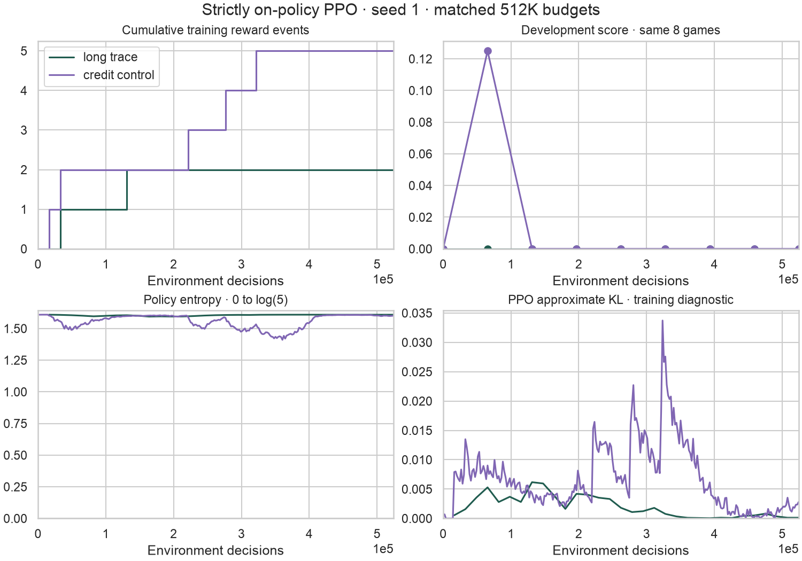

# Strictly on-policy PPO · long trace · 512K

The long-trace policy does not exceed both random and its initialization; useful on-policy learning remains unestablished.

## Matched method

Fresh seed 1, four monochrome frames, unchanged CNN and PPO implementation, original score reward. Rollout length 1024, gamma 0.999 and lambda 1.0 are compared with the earlier on-policy control's 128, 0.995 and 0.98. Both use minibatches of 128, four epochs, learning rate 0.0005 and entropy coefficient 0.01. Both receive exactly 524,288 decisions and 16,384 optimizer updates; long trace has 32 larger rollouts, control 256 smaller ones. The control includes its 64K parent and continuation. This is a bundled credit-assignment test with changed update/RNG timing, not a single-factor causal result.

## Original-score results

| Policy | Scoring games | Mean score | Mean decisions per game |
| --- | ---: | ---: | ---: |
| long trace | 2/128 | 0.01562 | 1288.4 |
| credit control | 1/128 | 0.00781 | 1290.6 |
| untrained | 2/128 | 0.01562 | 1312.2 |
| random | 3/128 | 0.02344 | 1273.9 |

Long trace found 2 training reward events in 396 completed games; control found 5 in 402. The reused equal-budget random rollout found 4 in 400. Discovery is distinct from learned policy skill. Measured long-trace training throughput: 132.2 decisions/s.

The eight development games are repeated monitoring data. The 128 final games, seeds 50000–50127, have also been inspected in earlier rounds. Paired comparisons in `analysis.json` are exploratory; they do not substitute for unused-seed confirmation and independent training-seed replication. Fresh initial-policy inference matched exactly and repeated random/no-op controls reproduced their episode arrays.

The actual-gameplay card uses preselected game seed 30016. No replay, demonstrations, auxiliary objectives or shaped rewards enter this trial. Longer lambda/rollout settings do not guarantee complete-episode Monte Carlo targets: episode boundaries stop credit and unfinished rollouts bootstrap. The on-policy learning objective remains actual scoring improvement.

## Final-checkpoint diagnostic

An additional 16,384 fresh decisions were collected only for gradient measurement after training; they produced 0 rewards. They are additional diagnostic interaction, outside the 524,288 training budget, and no diagnostic weights were saved or used to continue training. This measurement overlapped final evaluation, so evaluation timings are not isolated throughput measurements.

The mean per-minibatch entropy-to-policy gradient-norm ratio was 0.223. Mean raw norms were 3.66e-05 for entropy and 0.000174 for policy. Both are small; this local measurement again does not show entropy dominating policy gradients. All 128 minibatches are measured at the same parameters, not along the four-epoch update trajectory. A reconstructed first-minibatch update, including saved Adam state, matched the actual PPO implementation to maximum state-element difference 1.49e-08.

These data do not identify the cause of the failed learning result or rule out an entropy-coefficient ablation. They show that increasing available credit alone did not produce a useful policy in this selected seed. There is no evidence here to promote this configuration or spend the unused confirmation bank. Reproduce the diagnostic with `JAX_PLATFORMS=cpu .venv/bin/python diagnose_ppo_entropy.py --runs runs/tetris/v2_long_trace_512k_seed1 --out runs/tetris/v2_long_trace_512k_seed1/post_training_gradients.json`, then run `summarize_long_trace.py`.

[Protocol](../../../ON_POLICY_CREDIT.md) · [diagnostic rationale](../entropy_diagnostic/RESULT.md) · [implementation log](../../../IMPLEMENTATION_LOG.md).
